# Document Parser Blueprint — reusing a production listing-pipeline architecture

Created: 2026-11-03

**Source:** a private production listing pipeline (commit `f18fca9`). All paths below are relative to that repo.
**Audience:** engineer building a generic, domain-neutral document parser.
**Code:** verbatim excerpts for every invariant and stage are in §11.
**Stack it proves out:** Next.js 16 App Router on Vercel, AI SDK 7 + Anthropic, Neon Postgres, Supabase Storage, vitest.

---

## 1. What the listing tool actually is

Strip away the coworking domain and the tool is a **messy-documents → validated structured records → external system** pipeline:

- **Input:** anything a broker sends — PDF brochures, xlsx/Google Sheet availability grids, pptx decks, `.eml` emails, web pages, SharePoint folders, JS-rendered decks, pasted text.
- **Output:** one schema-valid record per entity (a "listing" = venue + N office line items), pushed to the backend API.
- **Between:** classify → extract (LLM, schema-constrained) → pin/normalize (code) → verify against source → validate → human review → idempotent push.

The domain lives in about 5 files. Everything else is reusable plumbing.

## 2. Pipeline shape

```mermaid
flowchart LR
  A[Sources<br/>file / URL / email / sheet] --> B[Acquire + classify<br/>magic bytes, bounded crawl]
  B --> C{Shape?}
  C -->|grid: xlsx/sheet| D[Model emits LAYOUT only<br/>code walks cells]
  C -->|text: pdf/pptx/eml/html| E[Model emits RAW strings<br/>code verifies by substring]
  C -->|no text: JS shell / scan| F[Screenshots -> vision blocks]
  D --> G[Canonical intermediate<br/>+ provenance per row]
  E --> G
  F --> E
  G --> H[Schema extraction<br/>pinned values not re-derived]
  H --> I[Pure normalize<br/>dates, currency, dedup, prose]
  I --> J[Deterministic validate<br/>hard vs soft checks]
  J --> K{Auto-push tier?}
  K -->|no| L[Human review card<br/>edits diffed = feedback]
  K -->|yes| M[Dry-run plan -> push<br/>idempotent, fail-soft per item]
  L --> M
```



## 3. The 8 invariants worth copying (the real blueprint)

These are the decisions that made the tool trustworthy. A document parser that keeps them gets the same properties regardless of domain.

1. **The model never re-derives numbers it can be handed.** Grid lane: the model sees a capped preview (`gridPreview`, 15k chars) and returns only a *layout descriptor* (which column means what, where rows start). Code then walks every cell by reference (`applyDescriptor`). Values are byte-faithful by construction. — `lib/batch-grid.ts`
2. **Text-lane values are verified against the source.** When the model must emit values (PDF/pptx/email), it emits *raw strings*; code normalizes them and checks each load-bearing field appears verbatim in the source text. A miss becomes a **warning**, never a silent keep or silent drop. — `sitesFromTextExtraction` in `lib/batch-text.ts`
3. **One schema file is the single source of truth.** JSON Schema with `additionalProperties: false`, required `confidence` + `missing` fields, closed vocabularies as enums (matching done model-side, code only whitelists). Lesson learned: a field absent from the schema *cannot* be emitted — the `min_term`/`lead_status` bug shipped every office as "open". — `lib/spec.ts` (`EXTRACT_SCHEMA`)
4. **Provenance on every row.** The intermediate carries a row reference (`doc:label#3`, sheet cell) per extracted item so validation and review can point at the exact source. — `lib/batch-intermediate.ts`
5. **Pure modules for every rule.** Normalizers, validators, planners, matchers import nothing server-only, so they're fixture-testable without mocks. 50+ test files ride on this. — `lib/build-listing.ts`, `lib/plan.ts`, `lib/batch-validate.ts`, `lib/tier.ts`
6. **Fail-soft per item, honest-degrade per feature.** One dead URL / bad row / failed photo never sinks the batch. Missing config (no DB, no token, no browser) returns a loud no-op, never a fake "clean" result. Nothing is ever fabricated. — `lib/source-spider.ts`, `lib/batch-verify.ts`, `lib/geocode.ts`
7. **Writes are planned, dry-run by default, and idempotent.** A pure planner produces the exact request ledger; a `DRY_RUN=1` env flag is the default; uploaded artifacts use deterministic paths (hash of source URL) so re-runs overwrite instead of orphaning. — `lib/plan.ts`, `lib/push.ts`, `lib/photos.ts`
8. **Human edits are training signal.** The AI draft vs the human-final record is diffed over editable keys and stored. That's your accuracy metric and eval set for free. — `lib/feedback.ts`

## 4. Stage-by-stage mapping

| # | Stage | Listing tool (file) | Document-parser equivalent | Reuse |
|---|-------|---------------------|----------------------------|-------|
| 1 | Acquire | `lib/web.ts` (SSRF-guarded fetch), `lib/sharepoint.ts`, `app/api/blob/upload` | Fetch URLs / accept uploads / pull shared folders | Copy |
| 2 | Classify | `lib/source-spider.ts` (magic bytes first, content-type advisory, bounded crawl) | Detect real file type, follow links inside docs, cap depth/bytes | Copy |
| 3 | To text | `lib/batch-text.ts` (pptx, eml, html linearize), `lib/xlsx.ts`, `lib/htmlutil.ts` (tables keep row structure) | Same; add DOCX if needed | Copy |
| 4 | Vision fallback | `lib/deck.ts` + `lib/chromium.ts` (JS-shell → slide screenshots), `lib/pdf-images.ts` | Scanned PDFs / image-only docs → vision blocks | Adapt |
| 5 | Lane split | `lib/batch-grid.ts` (grid) vs `lib/batch-text.ts` (text) | Tabular docs vs prose docs | Copy pattern |
| 6 | Extract | `extract()` in `lib/agent.ts` → `ask()` in `lib/ai.ts` (schema + system methodology + 16k max tokens + today's date) | Same call; swap schema + methodology prompt | Adapt |
| 7 | Pin | `applyPins` in `lib/agent.ts`, `lib/batch-intermediate.ts` | Deterministic values override model output | Copy pattern |
| 8 | Normalize | `lib/build-listing.ts` (now-words→today, currency, name-dedup), `lib/prose.ts` | Dates, currency, units, dedup | Adapt rules |
| 9 | Enrich (opt.) | `lib/marketplaces.ts` (pure adapters, explicit values only), `lib/geocode.ts` | Lookups against reference data | Pattern only |
| 10 | Validate | `lib/batch-validate.ts` (match by key not index, `hardFail` vs soft), `lib/batch-verify.ts` (read-only dupe check → flags, never auto-merge) | Reconcile record vs source; duplicate detection in target | Copy pattern |
| 11 | Gate | `lib/tier.ts` `pushable()` | Auto-accept only when complete | Adapt |
| 12 | Review | Chat draft card (`app/chat/ChatClient.tsx`), `/admin`, `lib/review-session.ts` | Review queue UI with per-field edit | Rewrite UI |
| 13 | Feedback | `lib/feedback.ts` `diffListing` | AI-vs-human diff store | Copy |
| 14 | Persist | `lib/storage.ts` (FS local / Neon prod, one jsonb table) | Same | Copy |
| 15 | Queue | `lib/batch-store.ts` `claimBuilding` (atomic `UPDATE…RETURNING`), re-upload dedup in `lib/batch-ingest.ts` | Job queue: one doc/entity per claim | Copy |
| 16 | Push | `lib/plan.ts` + `lib/push.ts` (phase A parent, phase B children, fail-soft per item) | Write to target system / webhook | Adapt |
| 17 | Progress | `lib/stream.ts` (`note()` via AsyncLocalStorage → NDJSON stream) | Live stage log to UI | Copy |
| 18 | Auth | `lib/authwall.ts` + `proxy.ts` (Basic Auth in proxy) | Same, or real auth | Copy |

## 5. Generic contracts

Directional shapes, not final types.

```text
SourceDoc      { id, kind: pdf|xlsx|pptx|eml|html|image|text, bytes|url, sha256, origin }
DocText        { docId, text, blocks[] (vision parts), tables[], mediaCount }
LayoutDescriptor (grid lane only)
               { tab, headerRow, firstDataRow, columns: { fieldName -> colLetter } }
Intermediate   { entities[]: { key, label, fields{}, items[]: { raw{}, normalized{}, provenance }, warnings[] } }
ExtractSchema  JSON Schema, additionalProperties:false, required includes confidence + missing
Record         schema-valid output, one per entity
Check          { id, ok, msg, soft:boolean }       -> hardFail(checks) blocks auto-accept
WritePlan      [{ method, path, body }]            -> executed only when DRY_RUN=0
FieldChange    { field, ai, final }                -> feedback table
```

The listing tool's names map as: building/site → **entity**, private office row → **item**, listing → **record**, amenities/facilities enum → **closed vocabulary**, backend API → **target**.

## 6. What to copy, adapt, drop

**Copy near-verbatim (domain-free):**
- `lib/web.ts`, `lib/source-spider.ts`, `lib/sharepoint.ts`, `lib/htmlutil.ts`, `lib/xlsx.ts`, `lib/batch-text.ts` (ingest helpers)
- `lib/ai.ts`, `lib/stream.ts`, `lib/http.ts`, `lib/storage.ts`, `lib/batch-store.ts`, `lib/feedback.ts`, `lib/authwall.ts`, `lib/keystore.ts`
- `lib/chromium.ts`, `lib/pdf-images.ts` (only if vision/image docs matter)

**Adapt (keep structure, replace domain rules):**
- `lib/spec.ts` → your schema + vocabularies + target body builders
- `lib/batch-grid.ts` / `lib/batch-intermediate.ts` → generic field map instead of office columns
- `lib/build-listing.ts` → your normalization rules
- `lib/batch-validate.ts`, `lib/tier.ts` → your reconciliation + completeness rules
- `lib/plan.ts` / `lib/push.ts` → your target API

**Drop (domain-specific):**
- `lib/marketplaces.ts`, `lib/browser.ts`, `lib/officehub-extract.ts`, `lib/geocode.ts`, `lib/photo-select.ts`, `lib/photos.ts`, `lib/description-spec.ts`, `lib/backlog.ts`, `PORT_LEDGER.md` + parity (Python-port artifacts)

## 7. Build sequence

Each phase ships something runnable. Estimates assume one engineer familiar with Next.js + AI SDK.

| Phase | Deliverable | Depends on | Est. |
|-------|-------------|------------|------|
| P1 | Ingest: upload/URL → classified `DocText` for pdf/xlsx/pptx/eml/html, SSRF + byte caps, fixture tests | — | 1–1.5 days |
| P2 | Schema + text-lane extraction with substring verification → warnings; `confidence`/`missing` surfaced | P1 | 1 day |
| P3 | Grid lane: layout descriptor over capped preview, code cell-walk, provenance per row | P1 | 1 day |
| P4 | Normalize + validate (hard/soft checks, match by key), completeness gate | P2, P3 | 1 day |
| P5 | Persistence + claim queue (Neon) + NDJSON progress stream | P2 | 0.5–1 day |
| P6 | Review UI: record card, per-field edit, warnings with provenance links; feedback diff on save | P4, P5 | 1.5–2 days |
| P7 | Write plan + dry-run + idempotent push to target | P4 | 0.5–1 day per target |
| P8 (opt.) | Vision fallback for scanned/JS-rendered docs | P2 | 0.5–1 day |

Total core (P1–P7): roughly 7–9 working days.

## 8. Testing approach to keep

- Every rule lives in a pure module → fixture tests with real sample docs under `tests/fixtures/` (the listing repo has 50+ such tests).
- Golden fixtures for extraction regressions: freeze N real documents + expected records; a schema or prompt change must keep them green.
- One smoke script per lane end-to-end (cf. `scripts/batch-smoke.ts`).
- Track the `feedback` diff rate per field over time as the accuracy metric.

## 9. Known traps (from the listing tool's history)

- **Output truncation:** 4096 max tokens cut a 20-row extraction mid-JSON. Size `maxTokens` to item count (tool uses 16384). — `lib/agent.ts`
- **Positional lists drift:** blank cells shift columns if rows are flattened to text. Walk cells by reference. — `lib/batch-grid.ts` header note
- **Index-zipped validation false-alarms:** match items by key/name, not array position. — `lib/batch-validate.ts`
- **Per-sheet caps drop data:** multi-tab workbooks hide the target in a later tab; bound by total chars, not per sheet. — `lib/xlsx.ts`
- **Content-type lies:** classify by magic bytes; column labels and headers are advisory only. — `lib/source-spider.ts`
- **JS-shell pages:** a fetched URL that reduces to <200 chars is a shell, not empty data — fall back to screenshots or fail loudly, never extract from nothing. — `finalize` in `lib/agent.ts`
- **Native structured output can stall:** `generateObject` grammar compilation timed out on the nested schema (multi-minute stalls). The tool embeds the schema in the system prompt, parses JSON itself, and does one repair ask; downstream code treats model JSON as untrusted. — `lib/ai.ts`
- **Vercel limits:** 4.5 MB request body → upload big files client-side to Blob; read-only FS → DB-backed storage in prod.

## 10. Open questions for the implementer

- Target system for P7 (DB, webhook, or third-party API)? Drives the planner shape.
- Is human review always required, or is there an auto-accept tier from day one?
- Scanned documents in scope? If yes, P8 moves up and OCR vs vision-model choice needs a decision.
- Multi-entity docs (one file → many records, like broker sheets) or one doc → one record? The claim queue only pays off for the former.


---

## 11. Code reference (verbatim from the repo)

Every block below is copied from the source repo with `sed -n START,ENDp` — line numbers are exact at commit `f18fca9`. Code is unmodified; only product/company names in comments are replaced with neutral terms. Domain names (office, site, listing, pcm) are left as-is; read them through the mapping in §5.

### Classify by magic bytes (invariant 6, stage 2)

`lib/source-spider.ts:121-145` — content-type is advisory; bytes decide the lane

```ts
// Magic bytes decide the class; the content-type header is advisory (share hosts and misconfigured
// CDNs lie — an HTML error page "served as" application/pdf must not become a corrupt file block).
export function sniff(data: Buffer, contentType: string): "pdf" | "image/jpeg" | "image/png" | "image/webp" | "image/avif" | "image/gif" | "image/bmp" | "image/tiff" | "xlsx" | "html" | "other" {
  if (data.subarray(0, 4).toString("latin1") === "%PDF") return "pdf";
  if (data[0] === 0xff && data[1] === 0xd8 && data[2] === 0xff) return "image/jpeg";
  if (data[0] === 0x89 && data[1] === 0x50 && data[2] === 0x4e && data[3] === 0x47) return "image/png";
  if (data.subarray(0, 4).toString("latin1") === "RIFF" && data.subarray(8, 12).toString("latin1") === "WEBP") return "image/webp";
  // avif/gif are CLASSIFY-only lanes: harvestPhotos already admits avif and photo-select's MEDIA map knows
  // it, so without them a legitimately selected image sniffs "other" and the batch photo sweep deletes it
  // as dead — x+why's own stable host (cdn.prod.website-files.com, Webflow) serves avif/webp (ENGINE §7x),
  // and galleries still emit gif. avif = an ftyp box at offset 4 whose brand is avif/avis (heic's ftyp
  // brands stay "other" — nothing downstream can read them). The crawl's image whitelist below is
  // deliberately NOT widened, so these fall through to the same skip they take today.
  if (data.subarray(4, 8).toString("latin1") === "ftyp" && /^avi[fs]/.test(data.subarray(8, 12).toString("latin1"))) return "image/avif";
  // bmp/tiff exist here only so photo-select's magic-byte probe matches its own MEDIA map: without them a
  // correctly-served image/bmp or image/tiff (which used to pass on its content-type header alone) sniffs
  // "other" and gets dropped before vision ever sees it.
  if (data[0] === 0x42 && data[1] === 0x4d) return "image/bmp";
  if (/^(II\*\0|MM\0\*)/.test(data.subarray(0, 4).toString("latin1"))) return "image/tiff";
  if (data.subarray(0, 4).toString("latin1") === "GIF8") return "image/gif";
  // a zip is only a workbook if it carries the sheet part — a docx/photo bundle would crash XLSX.read
  if (isZip(data)) return data.includes("xl/workbook.xml") ? "xlsx" : "other";
  if (/html/i.test(contentType) || /^\s*<(!doctype|html)/i.test(data.subarray(0, 512).toString("latin1"))) return "html";
  return "other";
}
```

### Bounded-crawl budget constants (invariant 6, stage 2)

`lib/source-spider.ts:28-43` — hard caps so one source can't eat the run

```ts
const MAX_DEPTH = 2; // seeds are depth 0
const MAX_FETCHES = 12;
const MAX_TOTAL_BYTES = 40_000_000;
const PER_FETCH_BYTES = 20_000_000; // matches the old remote-brochure cap in agent.attachmentBytes
const FETCH_TIMEOUT = 12_000;
const SEED_TIMEOUT = 25_000; // labeled seeds (brochure/floorplan/website) keep the old attachmentBytes patience
const CRAWL_DEADLINE = 60_000; // route maxDuration=300 at CONCURRENCY 3 — one building can't eat the run
const PDF_CAP = 4;
const NONDOC_PDF_CAP = 2; // photo-eligible PDFs run pdfImages (mupdf, ~300MB RSS each) — bound hard
const PDF_BYTES_CAP = 20_000_000; // combined PDF payload: each becomes a base64 file block in one API call
const IMG_CAP = 8; // gallery image files -> extract vision blocks; matches photo-select's DOC_CAP
const PAGE_TEXT_CAP = 12_000; // per page, under ingestAttachments' 20k lane cap
const PAGE_TEXT_TOTAL = 40_000; // across all crawled pages — extract's context isn't infinite
const PAGE_LINKS_CAP = 5;
const PAGE_IMGS_CAP = 5;
const PDF_LINKS_CAP = 5;
```

### Capped grid preview for the model (invariant 1, stage 5)

`lib/batch-grid.ts:82-105` — model sees a sample, never the full grid

```ts
export function gridPreview(tabs: GridTab[], capChars = 15_000): string {
  const out: string[] = [];
  const perTab = Math.max(2_000, Math.floor(capChars / Math.max(1, tabs.length)));
  for (const t of tabs) {
    const lines: string[] = [`## tab "${t.name}" (${t.rows} rows)`];
    const picked = new Set<number>();
    const pick = (r: number) => {
      if (r >= 0 && r < t.rows && !picked.has(r)) picked.add(r);
    };
    for (let r = 0; r < Math.min(10, t.rows); r++) pick(r);
    const step = Math.max(1, Math.floor(t.rows / 12));
    for (let r = 10; r < t.rows; r += step) pick(r);
    pick(t.rows - 1);
    for (const c of t.cells) if (UK_PC.test(c.v)) pick(c.r); // block anchors must be visible
    const rows = [...picked].sort((a, b) => a - b);
    for (const r of rows) {
      const line = rowText(t.cells, r);
      if (line) lines.push(`R${r + 1}  ${line}`);
      if (lines.join("\n").length > perTab) break;
    }
    out.push(lines.join("\n"));
  }
  return out.join("\n\n").slice(0, capChars);
}
```

### Layout descriptor type + schema (invariant 1, stage 5)

`lib/batch-intermediate.ts:86-125` — the model's ONLY output in the grid lane

```ts
export interface SheetDescriptor {
  tabs: TabDescriptor[];
  source_date: string | null; // best-effort from title cells / tab names
  operator: string | null; // best-effort guess, user confirms
}

// JSON schema for ask() — generated structure; the FACILITIES list used in draft-time prompts is
// exported below so no whitelist is ever hand-typed again (SOP §7h).
export const DESCRIPTOR_SCHEMA = {
  type: "object",
  properties: {
    tabs: {
      type: "array",
      items: {
        type: "object",
        properties: {
          tab: { type: "string" },
          layout: { enum: ["long", "blocks", "none"] },
          stale_copy: { type: "boolean" },
          header_row: { type: ["integer", "null"] },
          data_start: { type: ["integer", "null"] },
          data_end: { type: ["integer", "null"] },
          building_col: { type: ["string", "null"], description: "column letter, e.g. 'B'" },
          columns: {
            type: ["object", "null"],
            properties: Object.fromEntries(OFFICE_COLS.map((k) => [k, { type: ["string", "null"] }])),
            additionalProperties: false,
          },
          currency: { type: ["string", "null"] },
        },
        required: ["tab", "layout"],
        additionalProperties: false,
      },
    },
    source_date: { type: ["string", "null"], description: "yyyy-mm-dd" },
    operator: { type: ["string", "null"] },
  },
  required: ["tabs", "source_date", "operator"],
  additionalProperties: false,
} as const;
```

### Deterministic cell walk (invariant 1, stage 5)

`lib/batch-grid.ts:249-292` — code applies the descriptor; doubts become warnings

```ts
export function applyDescriptor(tabs: GridTab[], desc: SheetDescriptor): ApplyResult {
  const warnings: string[] = [];
  const stats = { unclaimed: 0, unmapped: 0 };
  const byLabel = new Map<string, BatchSite>();
  const seen = new Set<string>(); // tabs walked, or deliberately skipped as a verified stale copy
  for (const td of desc.tabs) {
    const tab = tabs.find((t) => t.name === td.tab);
    if (!tab) {
      warnings.push(`${td.tab}: in the layout, not in the file`);
      continue;
    }
    if (td.stale_copy) {
      if (verifiedStaleCopy(tab, tabs)) {
        warnings.push(`${td.tab}: skipped as a stale copy`);
        seen.add(tab.name);
        continue;
      }
      warnings.push(`${td.tab}: called a stale copy but looks unique — read anyway`);
    }
    if (td.layout === "none") continue;
    seen.add(tab.name);
    applyTab(tab, td, byLabel, warnings, stats);
  }
  // tripwire for the §7z failure: a tab the descriptor omitted (or called layout:"none" because the
  // preview showed screenshots) that nevertheless holds an office table. The model reads a CAPPED
  // preview, so "graphical tab" is a guess — code checks the whole grid and makes the human look.
  for (const t of tabs) {
    if (seen.has(t.name)) continue;
    const n = tabularRows(t);
    if (n >= 2) warnings.push(`${t.name}: skipped but has ${n} numeric rows — check the layout`);
  }
  mergeSharedIdentity(byLabel, warnings);
  // inert sites — no offices, no links, no postcode — are summary-table echoes (an "Area|Station|
  // Building" portfolio tab walked as long layout), not draftable buildings: there is nothing to pin
  // and nothing to crawl. Dropped into ONE warning so the resolution screen stays readable; a real
  // venue-only building keeps its anchor postcode (or links) and survives this.
  flagLabelSubsets(byLabel, warnings);
  const inert = [...byLabel.entries()].filter(([, s]) => !s.offices.length && !s.links.length && !s.postcode);
  if (inert.length) {
    for (const [k] of inert) byLabel.delete(k);
    warnings.push(`${inert.length} summary rows dropped, nothing to draft — ${inert.map(([, s]) => s.sheet_label).slice(0, 8).join(", ")}${inert.length > 8 ? ", …" : ""}`);
  }
  return { sites: [...byLabel.values()], warnings, ...stats };
}
```

### Raw-row normalization with provenance (invariants 4, 5; stage 8)

`lib/batch-intermediate.ts:195-260` — one raw row -> one typed item, quote kept verbatim

```ts
// One raw row -> a BatchOffice, or null when the row is empty / carries an exclusion marker.
// GBP: pcm int + verbatim quote. Non-GBP: pcm null + verbatim quote (buildListing's currency rules
// take it from there — USD converts with working, EUR stays flagged). per_desk × desks fills a blank
// GBP pcm deterministically, with the working recorded in the quote.
export function normalizeOffice(cells: RawOfficeCells, currency: string, provenance: string, rawLine: string): BatchOffice | null {
  if (EXCLUDE_ROW.test(rawLine)) return null;
  const name = cleanCellNumber(String(cells.office ?? "").trim()) || null;
  const { capacity, range } = parseCapacity(cells.desks);
  const sqft = parseAmount(cells.sqft);
  const gbp = /^gbp$/i.test(currency);
  const pcmRaw = String(cells.pcm ?? "").trim();
  const perDeskRaw = String(cells.per_desk ?? "").trim();
  let pcm: number | null = null;
  let quote: string | null = pcmRaw || null;
  if (gbp) {
    const n = parseAmount(pcmRaw);
    if (n != null) {
      pcm = Math.round(n);
      quote = pcmRaw.match(/[£\d]/) ? pcmRaw : `£${pcm}/mo`;
    } else if (perDeskRaw && capacity != null) {
      const pd = parseAmount(perDeskRaw);
      if (pd != null) {
        pcm = Math.round(pd * capacity);
        quote = `£${pd}/desk × ${capacity} desks = £${pcm}/mo`;
      }
    }
  } else if (!quote && perDeskRaw) {
    quote = `${perDeskRaw}/desk`;
  }
  let available = String(cells.available ?? "").trim() || null;
  if (available && EPOCH_DATE.test(available)) available = null; // Excel epoch junk (SOP §7b)
  // A held unit keeps its row (deleting it breaks officesReconcile's count parity) and NULLS availability:
  // buildListing's now-word lane would otherwise stamp TODAY on a let suite. The raw line keeps the
  // verbatim "UNDER OFFER" evidence either way.
  const lead = leadFrom(available, cells, rawLine);
  if (lead) available = null;
  const noteParts = [String(cells.notes ?? "").trim(), range ? `desk range ${range} — capacity uses the lower bound` : ""].filter(Boolean);
  // Plenty of broker tabs carry no desks COLUMN at all and state the count in prose instead ("22 desks, 10
  // person dedicated boardroom", "Space for 16 desks") — the manual loop read those by eye. Derived only
  // when the column gave nothing, and the derivation is recorded so a reviewer can see where it came from.
  let derived: string | null = null;
  let capacityOut = capacity;
  if (capacityOut == null) {
    const m = `${cells.notes ?? ""} ${cells.office ?? ""}`.match(/(\d+)\s*(?:x\s*)?(?:desks?|workstations?|people|persons?)\b/i);
    if (m) {
      capacityOut = parseInt(m[1], 10);
      derived = `capacity ${capacityOut} read from the source's own description ("${m[0]}") — no desks column on this tab`;
      noteParts.push(derived);
    }
  }
  const floor = String(cells.floor ?? "").trim() || null;
  if (!name && capacity == null && pcm == null && !quote && sqft == null) return null; // empty row
  return {
    name,
    capacity: capacityOut,
    pcm,
    price_quote: quote,
    available,
    ...(lead ? { lead_status: lead } : {}),
    area_sqft: sqft != null ? Math.round(sqft) : null,
    floor,
    note: noteParts.join(". ") || null,
    raw: rawLine,
    row: provenance,
  };
}
```

### Text lane: verify by substring (invariant 2, stage 5)

`lib/batch-text.ts:159-194` — values not found in the source become warnings

```ts
const collapse = (s: string) => s.toLowerCase().replace(/\s+/g, " ").trim();

// Model output + the source text it was lifted from -> BatchSites, with a substring verification per
// office: the load-bearing values (name / desks / pcm) must literally appear in the document. A miss
// doesn't drop the office — it becomes a site warning the resolution screen shows (human checkpoint).
export function sitesFromTextExtraction(ex: TextExtraction, sourceText: string, docLabel = "doc"): { sites: BatchSite[]; warnings: string[] } {
  const hay = collapse(sourceText);
  const warnings: string[] = [];
  const sites: BatchSite[] = [];
  for (const s of ex.sites) {
    const site: BatchSite = {
      key: siteKey(s.label),
      sheet_label: s.label,
      name: s.label,
      currency: (s.currency || "GBP").toUpperCase(),
      postcode: s.postcode ?? null,
      website: s.website ?? null,
      links: s.website ? [{ url: s.website, kind: "website" }] : [],
      offices: [],
      warnings: [],
    };
    s.offices.forEach((o, i) => {
      const office = normalizeOffice(o, site.currency, `${docLabel}:${s.label}#${i + 1}`, o.raw);
      if (!office) return;
      for (const [field, v] of [["office", o.office], ["desks", o.desks], ["pcm", o.pcm]] as const) {
        if (v && !hay.includes(collapse(String(v)))) {
          site.warnings.push(`${office.row}: ${field} "${v}" not found verbatim in the document — verify`);
        }
      }
      site.offices.push(office);
    });
    if (!hay.includes(collapse(s.label))) site.warnings.push(`building label "${s.label}" not found verbatim in the document`);
    sites.push(site);
  }
  return { sites, warnings };
}
```

### Extraction schema (invariant 3, stage 6)

`lib/spec.ts:61-120` — additionalProperties:false, confidence + missing required

```ts
// --- extraction schema (grounded in the DB fields). Raw JSON Schema for the AI SDK jsonSchema(). ---
export const EXTRACT_SCHEMA = {
  type: "object",
  additionalProperties: false,
  required: ["name", "address", "description_raw", "amenities", "venue_office_type", "facilities", "private_offices", "confidence", "missing"],
  properties: {
    name: { type: "string", description: "building/space name, e.g. '54 Charlotte Street'" },
    website: { type: ["string", "null"], description: "the building's own page URL on the operator site, if the sources show one" },
    address: {
      type: ["string", "null"],
      description: "full street address INCLUDING any building-name parts, e.g. 'East, Works, 75 Whitechapel Rd' — city/postcode in their own fields",
    },
    postcode: { type: ["string", "null"] },
    city: { type: ["string", "null"], description: "usually London" },
    country: {
      type: ["string", "null"],
      description: "country the building is in, e.g. 'USA', 'Germany', 'Ireland' — omit or null for the United Kingdom",
    },
    how_to_get_here: { type: ["string", "null"], description: "nearest stations / directions, e.g. '3 min walk from Holborn'" },
    description_raw: { type: "string", description: "factual notes, verbatim-ish from sources" },
    amenities: { type: "array", items: { type: "string" }, description: "free-text amenity phrases" },
    venue_office_type: {
      anyOf: [{ type: "string", enum: [...OFFICE_TYPES] }, { type: "null" }],
      description: "building-wide tenure when stated for the WHOLE building; offices with null office_type inherit it downstream",
    },
    facilities: {
      type: "array",
      items: { type: "string", enum: Object.keys(FACILITIES) },
      description:
        "building facilities explicitly evidenced in the sources; choose ONLY from this list, mapping the operator's own phrasing to the closest name (e.g. 'secure cycle hub' -> 'Bike storage', 'front of house team' -> 'Reception'); '24 hour access' means tenant access round the clock, NOT 24-hour security/CCTV; empty array when none are clearly stated",
    },
    private_offices: {
      type: "array",
      items: {
        type: "object",
        additionalProperties: false,
        required: ["name", "capacity", "price_per_month"],
        properties: {
          name: { type: ["string", "null"], description: "office id/label, e.g. '4.28'" },
          floor: { type: ["string", "null"] },
          capacity: { type: ["integer", "null"], description: "desks" },
          area_sqft: { type: ["number", "null"] },
          price_per_month: { type: ["number", "null"], description: "£ PCM (ex-VAT); null if only £PSF/TBC" },
          price_quote: { type: ["string", "null"], description: "raw pricing text, verbatim" },
          // API structured-outputs rejects enum on a union type — anyOf is the compliant form
          office_type: { anyOf: [{ type: "string", enum: [...OFFICE_TYPES] }, { type: "null" }] },
          available_from: { type: ["string", "null"], description: "ISO date; 'available now' -> today" },
          min_term: { type: ["integer", "null"], description: "minimum term in MONTHS (e.g. 12, 24, 36); null -> defaults to 3" },
          lead_status: {
            anyOf: [{ type: "string", enum: [...LEAD_STATUSES] }, { type: "null" }],
            description: "available/available now -> open; under offer/reserved -> reserved; let -> let",
          },
          description: { type: ["string", "null"] },
        },
      },
    },
    confidence: { type: "string", enum: ["high", "medium", "low"] },
    missing: { type: "array", items: { type: "string" } },
  },
} as const;
```

### Extraction call (stage 6)

`lib/agent.ts:392-410` — schema + methodology + date, 16k token headroom

```ts
// Claude structured extraction into the DB-grounded schema. Prepends TODAY'S DATE for 'available now'.
export function extract(
  spaceName: string,
  operator: string | null,
  researchText: string,
  sourceText: string,
  blocks: Part[] = [],
): Promise<Extracted> {
  const text =
    `TODAY'S DATE: ${today()} (use it for 'available now')\n` +
    `SPACE: ${spaceName}  (operator: ${operator || "unknown"})\n\n` +
    `=== WEB RESEARCH (may already include public pricing) ===\n${researchText}\n\n` +
    `=== BROCHURE / AVAILABILITY (user-supplied) ===\n${sourceText || "(none — use research)"}\n\n` +
    `Extract the venue + its private offices into the schema. Follow the methodology exactly.`;
  const content: Content = [...blocks, { type: "text", text }];
  // 4096 truncated a 20-office availability sheet on Sonnet 5 (finishReason=length); extraction JSON
  // scales with office count, so give it the same headroom as research.
  return ask<Extracted>(content, { schema: EXTRACT_SCHEMA as object, system: METHODOLOGY, maxTokens: 16384 });
}
```

### Schema-in-prompt LLM wrapper (stage 6)

`lib/ai.ts:58-127` — generateText with the JSON Schema embedded in the system prompt + one repair ask (NOT generateObject — see §9), friendly errors, spend tally

```ts
export type Part =
  | { type: "text"; text: string }
  | { type: "file"; data: string | Uint8Array; mediaType: string };
export type Content = string | Part[];

interface AskOpts {
  schema?: object;
  model?: string;
  system?: string;
  webSearch?: boolean;
  maxTokens?: number;
}

// Model reply -> object. Tolerates ```json fences; throws on non-JSON. Ported from _parse_json_reply.
export function parseJsonReply<T>(text: string): T {
  return JSON.parse(text.trim().replace(/^\s*```(?:json)?\s*|\s*```\s*$/g, "")) as T;
}

export async function ask<T = unknown>(content: Content, opts: AskOpts = {}): Promise<T> {
  const { schema, model, system, webSearch, maxTokens = 4096 } = opts;
  const apiKey = await getKey("ANTHROPIC_API_KEY");
  if (!apiKey) throw new Error("No Anthropic credentials — paste your key in the 🔑 panel (or set ANTHROPIC_API_KEY).");
  const anthropic = createAnthropic({ apiKey });
  const modelId = model || modelStore.getStore() || DEFAULT_MODEL;
  const m = anthropic(modelId);
  const wantJson = !!schema && !webSearch;

  // Schema calls do NOT use server-side structured outputs (generateObject) — the grammar compiler
  // chokes on our nested schema ("Grammar compilation timed out", multi-minute stalls). Port of
  // claude_client.ask: embed the schema in the system prompt, parse the JSON reply here with ONE
  // repair ask. Downstream coercion (officeBody/buildListing) already treats model JSON as untrusted.
  const sys = wantJson
    ? (system ? system + "\n\n" : "") +
      "Respond with ONLY one JSON object matching this JSON Schema — no prose, no code fences, no explanations:\n" +
      JSON.stringify(schema)
    : system;
  const messages: Array<{ role: "user" | "assistant"; content: Content }> = [{ role: "user", content }];

  const run = async (): Promise<string> => {
    const r = await generateText({
      model: m,
      system: sys,
      maxOutputTokens: maxTokens,
      ...(webSearch ? { tools: { web_search: anthropic.tools.webSearch_20250305({ maxUses: 5 }) }, stopWhen: stepCountIs(6) } : {}),
      messages,
    });
    tally(modelId, r.usage);
    if (r.finishReason === "length") throw new Error(`reply truncated at maxOutputTokens=${maxTokens} — raise the cap`);
    return r.text;
  };

  try {
    const text = await run();
    if (!wantJson) return text as T;
    try {
      return parseJsonReply<T>(text);
    } catch (e) {
      // one repair ask, then honest failure — mirrors claude_client.ask
      messages.push({ role: "assistant", content: text });
      messages.push({
        role: "user",
        content: `That reply failed to parse as JSON (${(e as Error).message}). Respond again with ONLY the corrected JSON object — no prose, no code fences.`,
      });
      return parseJsonReply<T>(await run());
    }
  } catch (e) {
    if (e instanceof Error && e.message.startsWith("reply truncated")) throw e;
    friendly(e);
  }
}
```

### Pinning (invariant 1, stage 7)

`lib/spec.ts:157-165` — deterministic values replace model output

```ts
// Batch-drafting pin application — pure and beside the types it mutates. Pinned offices REPLACE
// extraction's (sheet rows are law; the model never re-derives numbers); extraMissing is PREPENDED
// (the update-candidate flag is contractually missing[0]). Returns whether offices were pinned —
// the caller must then skip marketplace price-fill (it would contaminate sheet fidelity).
export interface FinalizePins {
  pinnedOffices?: ExtractedOffice[];
  extraMissing?: string[];
  pinnedName?: string; // byte-exact final listing name (update candidates) — buildListing's operator prefix must not touch it
}
```

### Check type (invariant 5, stage 10)

`lib/batch-validate.ts:10-14` — one shape for every validation result

```ts
export interface Check {
  id: string;
  ok: boolean;
  detail: string;
}
```

### Reconcile by key, not index (stage 10)

`lib/batch-validate.ts:18-50` — every pinned item must survive unchanged

```ts
// offices reconcile: every pinned unit present in the built listing with the same capacity/pcm/sqft.
// Pinned pcm null (non-GBP / POA) may legitimately become a number downstream (buildListing's USD
// conversion) — only a CHANGED non-null pcm or a lost unit is a failure.
function officesReconcile(listing: Listing, site: BatchSite): Check {
  const expected = sitesToOffices(site);
  // multiset by name: two NULL-named units (or dup names that slipped through) must each consume
  // their own slot — a single-slot Map would false-alarm one of them forever
  const built = new Map<string, Listing["private_offices"]>();
  for (const o of listing.private_offices) {
    const k = norm(o.name);
    (built.get(k) ?? built.set(k, []).get(k)!).push(o);
  }
  const problems: string[] = [];
  for (const e of expected) {
    const pool = built.get(norm(e.name));
    const b = pool?.shift();
    if (!b) {
      problems.push(`unit "${e.name}" missing from draft`);
      continue;
    }
    if (e.capacity != null && b.capacity !== e.capacity) problems.push(`"${e.name}" capacity ${b.capacity} ≠ sheet ${e.capacity}`);
    if (e.price_per_month != null && b.price_per_month !== e.price_per_month)
      problems.push(`"${e.name}" pcm ${b.price_per_month} ≠ sheet ${e.price_per_month}`);
    if (e.area_sqft != null && b.area_sqft !== e.area_sqft) problems.push(`"${e.name}" sqft ${b.area_sqft} ≠ sheet ${e.area_sqft}`);
  }
  if (listing.private_offices.length !== expected.length)
    problems.push(`office count ${listing.private_offices.length} ≠ sheet ${expected.length} (name-dedup collapse or extra rows)`);
  return {
    id: "offices_reconcile",
    ok: !problems.length,
    detail: problems.length ? problems.join("; ") : `${expected.length} unit(s) byte-faithful to the sheet`,
  };
}
```

### Hard vs soft failures (stage 10)

`lib/batch-validate.ts:166-171` — soft = needs a human, not a re-draft

```ts
// SOFT = a flag on a GOOD payload, not a broken draft: a late prod match, a postcode disagreement, a
// WAF-suspected sweep and a photo reused from another building all need a human, not a re-draft (a retry
// would rebuild the identical state). Everything else failing means the draft misrepresents the sheet or
// breaks the review contract.
const SOFT = new Set(["photos_min5", "prod_dedup", "postcode_agreement", "low_confidence_hold", "photo_cross_building", "photo_sweep_waf_suspected"]);
export const hardFail = (checks: Check[]): boolean => checks.some((c) => !c.ok && !SOFT.has(c.id));
```

### Auto-accept gate (stage 11)

`lib/tier.ts:1-10` — strict completeness check before skipping review

```ts
// Is a draft complete enough to push to the backend WITHOUT a human first? The auto-push "safe tier".
// Deliberately strict: a listing must have a name, an address, real coordinates (a venue with null
// lat/lng stays hidden on the site), a cover image, and at least one listable office. Anything short
// of this stays in /review for a person. Ported intent from the Python agent's tiered-approve.
import type { Listing } from "./spec";

export function pushable(listing: Listing): boolean {
  const hasOffice = (listing.private_offices ?? []).some((o) => o.name || o.capacity || o.price_per_month);
  return Boolean(listing.name && listing.address && listing.latitude != null && listing.longitude != null && listing.cover_image && hasOffice);
}
```

### AI-vs-human diff (invariant 8, stage 13)

`lib/feedback.ts:1-22` — field-level diff over editable keys

```ts
// AI-draft vs human-final diff — the training-feedback signal ("what did the AI get wrong?"). Compares
// exactly the fields a human can change on the card (EDIT_KEYS), by JSON equality: arrays/objects
// (private_offices, amenities, photos) are compared whole and stored whole, so element-level analysis is
// possible later without re-instrumenting. Pure (no server-only) so it's unit-testable.
import { EDIT_KEYS } from "./switches";
import type { Listing } from "./spec";

export interface FieldChange {
  field: string;
  ai: unknown;
  human: unknown;
}

export function diffListing(ai: Partial<Listing>, final: Partial<Listing>): FieldChange[] {
  const out: FieldChange[] = [];
  for (const k of EDIT_KEYS) {
    const a = (ai as Record<string, unknown>)[k] ?? null;
    const h = (final as Record<string, unknown>)[k] ?? null;
    if (JSON.stringify(a) !== JSON.stringify(h)) out.push({ field: k, ai: a, human: h });
  }
  return out;
}
```

### Persist with AI-draft baseline + provenance (stage 14)

`lib/storage.ts:246-267` — pristine AI output kept beside the working copy

```ts
// ai_draft snapshots the pristine AI output alongside the working copy; a RE-draft overwrites it (a fresh
// AI attempt is a fresh baseline), while human edits (updateListing) never touch it.
// `source` records provenance in source_url — chat drafts keep the historical 'chatbot', batch
// drafting passes 'batch:<id>' so /review and audits can trace a draft to its run.
export async function saveListing(listing: Listing, source = "chatbot"): Promise<string> {
  if (sql) {
    await ensureSchema();
    await sql`INSERT INTO listings(operator, space_key, status, source_url, listing, ai_draft, updated)
              VALUES(${listing.operator}, ${listing.space_key}, 'enriched', ${source}, ${JSON.stringify(listing)}::jsonb, ${JSON.stringify(listing)}::jsonb, now())
              ON CONFLICT(operator, space_key) DO UPDATE SET
                status='enriched', source_url=${source}, listing=EXCLUDED.listing, ai_draft=EXCLUDED.ai_draft, updated=now()`;
    return `${listing.operator}/${listing.space_key}`;
  }
  const p = writeListingFile(listing);
  try {
    fs.writeFileSync(path.join(dirFor(listing.operator, listing.space_key), "ai_draft.json"), JSON.stringify(listing, null, 1));
  } catch {
    /* snapshot is best-effort on the file backend */
  }
  await cupsert(listing.operator, listing.space_key, "enriched", { source_url: source });
  return p;
}
```

### Atomic queue claim (stage 15)

`lib/batch-store.ts:177-194` — single UPDATE...RETURNING, stale-worker reclaim

```ts
// THE atomic claim. A single UPDATE...RETURNING so two workers racing on the same building can't both
// win: one of queued/failed (fresh work), a drafting row stuck past 6 minutes (worker died mid-draft —
// reclaimed as if failed), or (force) a done/skipped row for an explicit redo. No match -> null, meaning
// someone else already holds it (or it's done and force wasn't passed).
export async function claimBuilding(batchId: string, key: string, opts?: { force?: boolean }): Promise<BatchBuildingRow | null> {
  const db = requireSql();
  await ensureSchema();
  const force = !!opts?.force;
  const rows = await db`
    UPDATE batch_buildings
    SET status='drafting', attempt=attempt+1, updated=now(), error=NULL
    WHERE batch_id=${batchId} AND key=${key}
      AND (status IN ('queued','failed')
           OR (status='drafting' AND updated < now() - interval '6 minutes')
           OR (${force} AND status IN ('done','skipped')))
    RETURNING *`;
  return rows.length ? (rows[0] as BatchBuildingRow) : null;
}
```

### Pure write planner (invariant 7, stage 16)

`lib/plan.ts:1-69` — exact request ledger, no I/O

```ts
// Pure push planner — reproduces push_listing()'s `planned` ledger exactly, with no fs/network/
// keystore/storage imports, so scripts/parity.test.ts can import it without tripping "server-only".
import { spaceBody, officeBody, DEFAULT_OWNER_ID, type Listing } from "./spec";

export interface PlannedCall {
  endpoint: string;
  body: Record<string, unknown>;
}
export interface Plan {
  planned: PlannedCall[];
  venueId: string;
  offices: number;
  skipped: { index: number; price_quote: string | null }[];
}

// Ported from push.push_listing's phase_a + phase_b log→ledger mapping:
//  - existing venue (registry) -> "SKIP space/create — venue already exists: <id>" with {venue_id}
//  - else                      -> "POST /api/space/create" with the full space body
//  - each mapped amenity       -> "POST /api/space/resource/amenity/add <matched> (<id8>…)" with {}
//  - each listable office      -> "POST /api/space/resource/create" with the office body
// venueId in dry mode is the literal "DRY_RUN" (as the Python emits); live callers pass the real id.
export function buildPlan(
  listing: Listing,
  opts: { ownerId?: string; existingVenueId?: string; venueId?: string; dry?: boolean } = {},
): Plan {
  const { ownerId = DEFAULT_OWNER_ID, existingVenueId = "", dry = true } = opts;
  const planned: PlannedCall[] = [];
  let venueId: string;
  if (existingVenueId && existingVenueId !== "DRY_RUN") {
    venueId = existingVenueId;
    planned.push({ endpoint: `SKIP space/create — venue already exists: ${venueId}`, body: { venue_id: venueId } });
  } else {
    planned.push({ endpoint: "POST /api/space/create", body: spaceBody(listing, ownerId) });
    venueId = opts.venueId ?? (dry ? "DRY_RUN" : "");
  }

  for (const a of listing.amenities ?? []) {
    if (a.amenity_id) {
      planned.push({
        endpoint: `POST /api/space/resource/amenity/add ${a.matched} (${a.amenity_id.slice(0, 8)}…)`,
        body: {},
      });
    }
  }

  // venue-level facilities — same single-line format (the log→ledger parser depends on it)
  for (const f of listing.facilities ?? []) {
    if (f.facility_id) {
      planned.push({
        endpoint: `POST /api/space/facility/add ${f.matched} (${f.facility_id.slice(0, 8)}…)`,
        body: {},
      });
    }
  }

  const skipped: { index: number; price_quote: string | null }[] = [];
  let i = 0;
  let offices = 0;
  for (const o of listing.private_offices ?? []) {
    i += 1;
    if (!(o.name || o.capacity || o.price_per_month)) {
      skipped.push({ index: i, price_quote: o.price_quote ?? null });
      continue;
    }
    planned.push({ endpoint: "POST /api/space/resource/create", body: officeBody(o, venueId) });
    offices += 1;
  }
  return { planned, venueId, offices, skipped };
}
```

### Deterministic artifact paths (invariant 7, stage 16)

`lib/photos.ts:24-39` — re-runs overwrite, never orphan

```ts
// FNV-1a (32-bit) — tiny stable non-crypto hash, pure JS (keeps this module dependency-free). Only used
// to derive a deterministic path; a collision is harmless (worst case two source URLs share one object,
// still a valid image).
function fnv1a(s: string): string {
  let h = 0x811c9dc5;
  for (let i = 0; i < s.length; i++) {
    h ^= s.charCodeAt(i);
    h = Math.imul(h, 0x01000193);
  }
  return (h >>> 0).toString(36);
}

export function rehostPath(spaceKey: string, sourceUrl: string): string {
  const name = baseName(sourceUrl.split("?")[0].split("#")[0]);
  return `photos/${sanitizeKey(spaceKey)}/ext/${fnv1a(sourceUrl)}-${safeName(name, 60)}`;
}
```

### Ambient progress stream (stage 17)

`lib/stream.ts:1-43` — note() anywhere -> NDJSON lines to the UI

```ts
// Live progress stream. Port of agent.note() (Python thread-local) — here an AsyncLocalStorage store
// makes note() ambient across the pipeline's awaits, and streamRun() drains it as NDJSON: one
// {type:"note",msg} line per stage, then a final {type:"result",result} or {type:"error",error}.
// The route sets runtime="nodejs" + maxDuration; the client reads the lines and shows them live.
import "server-only";
import { AsyncLocalStorage } from "node:async_hooks";

type Emit = (msg: string) => void;
const als = new AsyncLocalStorage<Emit>();

// ambient progress note — no-op (logs) outside a streamed run, so research()/finalize() stay callable
// directly (e.g. in a non-streaming context) without wiring.
export function note(msg: string): void {
  const emit = als.getStore();
  if (emit) emit(msg);
  else console.log(msg);
}

// Run `fn`, streaming its note()s as NDJSON followed by the result (or error). Returns a Response.
export function streamRun<T>(fn: () => Promise<T>): Response {
  const stream = new ReadableStream<Uint8Array>({
    async start(controller) {
      const enc = new TextEncoder();
      const write = (o: unknown) => controller.enqueue(enc.encode(JSON.stringify(o) + "\n"));
      const emit: Emit = (msg) => write({ type: "note", msg });
      try {
        const result = await als.run(emit, fn);
        write({ type: "result", result });
      } catch (e) {
        write({ type: "error", error: (e as Error).message || String(e) });
      } finally {
        controller.close();
      }
    },
  });
  return new Response(stream, {
    headers: {
      "Content-Type": "application/x-ndjson; charset=utf-8",
      "Cache-Control": "no-store, no-transform",
      "X-Accel-Buffering": "no", // don't let a proxy buffer the stream
    },
  });
}
```

